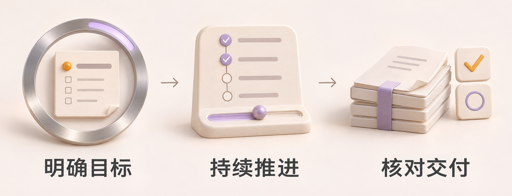
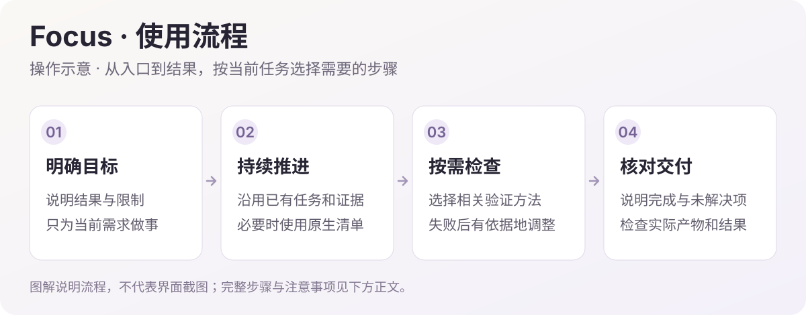

# DSH 执行增强


独立的 DeepSeek Harness 插件。面向调研比较、资料整理、文稿、数据处理、文件与应用操作，也保留开发专项能力。按任务自动选择方法，围绕用户目标持续推进，依据实际成果交付。普通说明以中文为主，必要的代码标识和命令保留原文。

## 自动选择工作方法

| 环节 | 适用情况 | 技能标识 |
| --- | --- | --- |
| 任务规划 | 多步任务缺少有效计划，或目标与完成条件不清楚 | `dsh-focus-planning` |
| 按计划执行 | 已有计划，需要开始或继续工作 | `dsh-focus-execution` |
| 针对性测试 | 代码逻辑、数据处理程序和可复现程序缺陷 | `dsh-focus-testing` |
| 定位修复 | 报错、材料矛盾、操作结果不符或重复失败 | `dsh-focus-debugging` |
| 结果检查 | 核对结论来源、文稿、数据、操作结果或代码行为 | `dsh-focus-review` |
| 交付核对 | 多项要求收尾，区分已完成与未完成 | `dsh-focus-delivery` |

技能标识用于宿主调用，必须符合英文小写与连字符格式；用户可读的名称、描述、正文、清单状态和执行提示使用中文。

多步任务先明确交付物与完成条件，建立简短的原生清单，再按步骤执行、核对结果和交付。调研检查来源和缺失项，数据处理核对口径与计算，文稿检查内容与格式，应用操作核对真实状态；代码任务继续使用针对性测试和代码检查。仅分析、建议或写稿不会自动扩展为写代码、建项目或执行外部操作。无需用户点名插件或逐项调用技能。

单条查询、短回答和明确的单步小改直接处理。已有有效计划、当前版本已读取的方法和仍有效的结果继续复用，信息足够就停止扩展检索；更新后的技能正文带版本号。用户最新要求和项目约定优先，具体领域技能可配合使用；不自动添加阶段审批、流程文档、哈希核验、提交、推送或子代理。

## 运行提醒

- **当前计划**：从原生清单事件恢复最多 8 项未完成步骤。完成一项或切换阶段时提醒同步进度；会话恢复后继续已有工作。计划完成或清空后摘要消失，独立新任务不沿用旧目标。
- **阶段衔接**：会话已采用执行增强方法后，结合本轮多步清单的完成进展和成功的文件写入、编辑操作，提示进入结果检查和交付核对。只读资料、不改文件的任务也可通过清单进展触发；清单全部完成后仍保留必要的检查提醒。阶段状态从 DSH 原生日志恢复，新轮次保留方法选择并重置进度。不以读取技能或清单完成代替实际检查，普通小事不强行进入流程。
- **变更后重查**：读取结果检查或交付方法后再次修改文件，提醒针对最新变更核对受影响的内容，沿用仍适用的方法和证据，不要求重跑全部检查。正常更新完成清单不触发重复检查。
- **首次失败**：提示区分预期失败、参数错误和产品缺陷，非预期失败进入定位修复。读取调试技能后消除已有提示，新的失败仍会提示。
- **重复失败**：同一轮次中相同操作出现至少两次相同失败时，提示根据原因调整方法。命令的界面展示文案不参与操作比较；命令非零退出码也会识别。
- **报告与退出码不一致**：执行 `node --test` 的前台命令即使返回 0，只要完整、未截断且唯一的 Node 原生汇总仍显示失败，就提醒不能声称检查通过。支持原生文本和 TAP 汇总；不从零散报错词猜测结果，不修改工具返回值。
- **及时清除**：同一操作成功后清除其失败记录；新一轮开始时清空失败提醒。取消不算失败，不同会话互不影响。

运行提醒复用原生清单与工具结果，不修改工具输出、不阻止操作、不额外调用模型。每个会话最多保留 24 条近期失败，参数和错误文本有长度限制；敏感参数及原始错误不会复制进提醒。相同失败采用精确比较，不能识别所有语义相同的故障。

阶段提醒依据原生清单及文件工具事件，不会自动理解所有连接器或应用的业务状态。尚未选择增强方法，或没有清单进展且仅通过终端、外部工具操作时，可能没有相同提示；模型仍须按已读方法核对结果。测试报告检测仅针对有界、可识别的 Node 原生汇总。历史清单与材料不是新指令或新授权，提示也不是完成证明；行为仍依赖当前模型理解和遵循规则。

## 安装

当前版本 **0.5.1** · [下载 Release 安装包](https://github.com/Missher12/Missher-DSH-Focus/releases/tag/v0.5.1)。支持 DSH **0.2.1-rc.4 / 0.2.2-rc.1**，分别兼容 Cordis **4.0.5 / 4.1.x**。DSH 版本范围保持明确，不绕过宿主兼容性检查。

在 DSH「插件 → 添加插件 → 安装第三方插件」中选择 `missher-dsh-focus-0.5.1.tgz` 并启用。使用宿主插件开关即可停用。

不增加自定义侧栏和设置页，进度沿用 DSH 原生清单；不创建第二份任务数据库，不修改其他插件的配置或私人数据。更新继续使用原插件实例。

<!-- visual-guide -->
<a id="visual-guide"></a>

## 图解使用流程

让多步骤任务保持方向；简单问题仍然直接处理。



<sub>场景插画：帮助理解用途与操作顺序，不是 DSH 界面截图。</sub>



[查看完整流程图](docs/images/workflow-guide.svg)

| 步骤 | 怎样操作 | 需要留意 |
| --- | --- | --- |
| 1. 给出目标 | 在正常 DSH 对话中写清要完成什么、材料在哪里，以及限制。 | 不需要为使用 Focus 新建额外任务数据库或单独侧栏。 |
| 2. 推进多步工作 | 研究、写作、资料整理、文件和应用任务可按需组织步骤。 | 已有计划和证据仍有效就继续用；简单问题不强制拆成完整流程。 |
| 3. 处理开发与失败 | 代码任务按需使用开发、测试、调试和审查方法。 | 方法由任务决定，不擅自创建子代理，不把失败测试说成通过。 |
| 4. 完成交付 | 检查实际文件、已运行检查和剩余问题。 | 原生清单状态帮助跟踪进展，不能代替检查真实交付物。 |

### 试一次

> 把我提供的资料整理成一份报告。先指出影响结论的关键缺口，能继续的部分直接推进；最终交付报告、主要依据和未解决事项。

使用后可以这样核对：

- 结果满足用户的目标与范围，没有顺手扩展工作。
- 实际运行的检查和未执行的检查分开报告。
- 遇到同因失败后调整方法，交付时不隐瞒残留问题。

### 使用与配置

| 项目 | 建议 |
| --- | --- |
| 使用入口 | 沿用普通 DSH 会话；Focus 不需要额外设置页才能发挥作用。 |
| 任务方法 | 通用任务和开发任务按需选用；不为每个小改动强制完整流程。 |
| 权限与协作 | 原有权限、用户授权和是否允许子代理的约定继续有效。 |

图中的清单表示多步骤任务的推进方式。Focus 提供工作方法与运行提醒，任务仍由当前 Agent 在真实工具和用户授权范围内执行。
<!-- /visual-guide -->

<!-- readme-expansion -->
## 使用场景

| 遇到的情况 | 怎样使用 |
| --- | --- |
| 任务有多步要求，进行一段时间后容易漏项 | 围绕目标维护简短原生清单，并在执行、结果检查和交付之间衔接。 |
| 同一个操作反复失败，仍在原样重试 | 根据工具结果提示定位原因，在重复失败后调整方法。 |
| 不写代码，也需要可靠地完成整理、写稿或调研 | 按任务选择资料、文稿、数据与应用操作的检查方式，不把所有工作变成代码测试。 |

## 常见问题

<details>
<summary>为什么没有独立设置页或侧栏？</summary>

Focus 复用 DSH 的技能、原生清单和工具结果。它主要影响任务方法与提醒，不增加第二套任务数据库。

</details>

<details>
<summary>它会自动创建子代理、提交 Git 或执行额外审批吗？</summary>

不会仅因为开启插件就获得这些授权。具体操作仍服从用户要求、项目约定和宿主权限。

</details>

<details>
<summary>开启后能保证模型不跑题、每次都完成吗？</summary>

不能。提醒依据可识别的事件触发，最终仍依赖模型理解与遵循规则；应依据真实结果判断，不把提示文本当作效果保证。

</details>

## 搭配使用

[Superagent](https://github.com/Missher12/Missher-DSH-Superagent) 管理独立任务和执行会话，Focus 提供任务方法；[Project Ops](https://github.com/Missher12/Missher-DSH-Project-Ops) 帮助查看任务产生的文件与方案。

## 升级与数据

当前安装包支持 DSH 0.2.1-rc.4 与 0.2.2-rc.1，保留相同插件实例和原会话。升级后按宿主提示加载新包，不通过版本豁免绕过准入检查。
<!-- /readme-expansion -->

## 开发与验证

使用 Node 24，安装开发依赖后执行：

```sh
pnpm install
pnpm check
pnpm pack --pack-destination dist
```

检查覆盖六项技能注册和卸载、清单与阶段恢复、只读资料任务的结果检查衔接、会话隔离、修改后重新核对、首次与重复失败、被退出码掩盖的测试失败、取消和上下文长度。集成检查使用实际 DSH 技能、工具与会话服务，测试输入为合成数据。

`tests/plugin.test.mjs` 适配两个版本的原生工具执行接口。0.2.2-rc.1 安装包可在只读官方 SDK 上执行隔离 Loader 检查，不使用日常 profile：`node tests/host-loader.mjs <SDK目录> <安装包.tgz> <新的隔离目录>`。这覆盖准入、加载、提示、工作流、结果钩子及卸载，不等于桌面界面或真实模型任务验收。

0.1.0 已在日常 DSH 完成一次活动报名网站开发实测，自动规划先于写代码，随后完成真实浏览器检查；0.1.1 的收尾复测自动选择交付核对并复用已有证据。后续版本以对应的实际会话与测试结果判断，不能仅凭提示词声称行为已经改善。

## 与 Superpowers 的关系

工作方法参考 [Superpowers](https://github.com/obra/superpowers) 的规划、连续执行、先复现再修复、代码检查和凭证据交付。六项技能按 DSH 原生接口独立实现，不依赖 Superagent 或 Superpowers 插件。

采用针对实际任务的必要检查，遵循用户的审批与子代理偏好。没有复制强制多轮审批、每步提交、自动派遣子代理或独立工作区等整套约束。

这是一套面向日常工作与开发的执行方法，尚无与关闭插件或 Superpowers 的系统性对照结果；不能保证模型每次都遵从，也不能量化跑题率下降。
