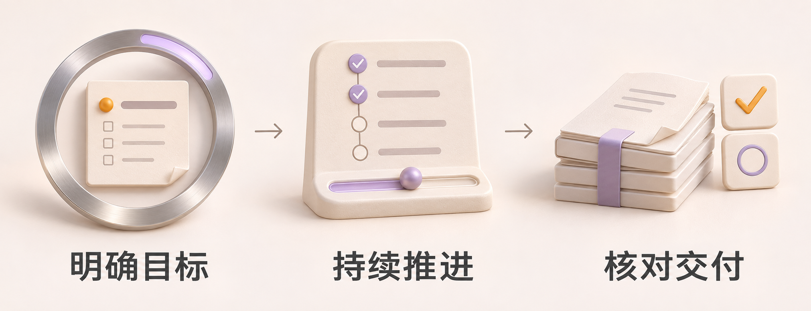
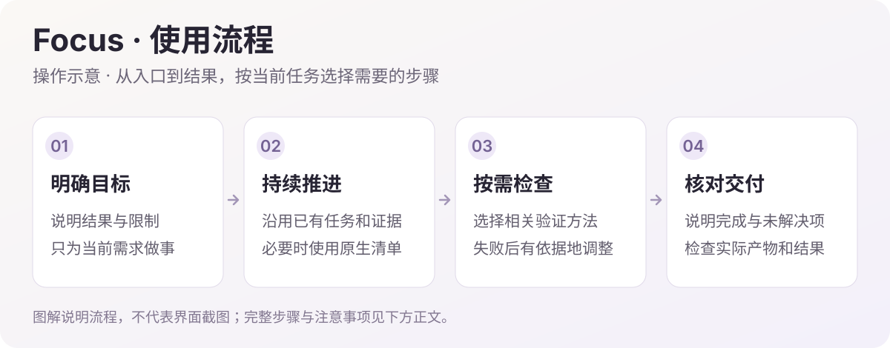

# DSH 执行增强


独立的 DeepSeek Harness 插件。面向调研比较、资料整理、文稿、数据处理、文件与应用操作，也保留开发专项能力。按任务自动选择方法，围绕用户目标持续推进，依据实际成果交付。普通说明以中文为主，必要的代码标识和命令保留原文。

## 工作方式

简单查询、短回答和明确的小改直接处理。多步任务先明确成果与完成条件，用 DSH 原生清单逐项推进，交付前核对实际成果。调研看来源，整理和数据核对原文与计算，开发验证实际行为。已有材料、技能和验证仍适用时直接复用。

六项技能保留原标识，遇到目标不清、难以恢复的任务、疑难故障、行为回归或高影响成果时按需查看。规划、执行、核对和交付的共同要求在短提示中一次给齐。

| 技能 | 使用时机 | 标识 |
| --- | --- | --- |
| 任务规划 | 成果或完成条件不明确 | `dsh-focus-planning` |
| 按计划执行 | 复杂任务恢复后当前步骤不清楚 | `dsh-focus-execution` |
| 针对性测试 | 代码行为回归或可复现缺陷 | `dsh-focus-testing` |
| 定位修复 | 非预期失败原因不明或同因重复失败 | `dsh-focus-debugging` |
| 结果检查 | 关键结论难以核对或高影响变更 | `dsh-focus-review` |
| 交付核对 | 多项成果的完成状态不明确 | `dsh-focus-delivery` |

## 运行提醒

- **计划**：原生清单完整结果仍可见时，只提示当前项、下一项和剩余数量。恢复对话时，或完整结果已被压缩，会从原生记录补回最多八项。历史清单仅供继续原任务。
- **成果核对**：多步清单取得进展时直接提示核对实际成果。核对后再次修改文件，提示复查受影响的部分。每轮重新判断阶段，清单标记和技能读取只是工作记录。
- **失败**：macOS 的 Bash 和 Windows 的 PowerShell 都会检查前台退出码。相同操作因同一原因失败两次时提醒换方法。完整、未截断的 Node 测试汇总如果仍显示失败，即使退出码为零也会提示。取消操作不触发，同一操作成功后清除对应提醒。

所有提醒通过宿主原生接口工作。每个会话最多保留 24 条近期失败，提醒不复制命令参数和原始错误。

## 安装

当前版本 **0.6.0**。支持 DSH **0.2.1-rc.4 / 0.2.2-rc.1 / 0.2.2-rc.3 / 0.2.2-rc.4**，兼容 Cordis **4.0.5 / 4.1.x**。[下载已发布的安装包](https://github.com/Missher12/Missher-DSH-Focus/releases)

在 DSH「插件 → 添加插件 → 安装第三方插件」中选择 `missher-dsh-focus-0.6.0.tgz` 并启用。Windows 与 macOS 使用同一安装包。使用宿主插件开关即可停用。

不增加自定义侧栏和设置页，进度沿用 DSH 原生清单；不创建第二份任务数据库，不修改其他插件的配置或私人数据。更新继续使用原插件实例。

<!-- visual-guide -->
<a id="visual-guide"></a>

## 图解使用流程

让多步骤任务保持方向；简单问题仍然直接处理。



<sub>场景插画：帮助理解用途与操作顺序，不是 DSH 界面截图。</sub>



[查看完整流程图](docs/images/workflow-guide.svg)

| 步骤 | 怎样操作 | 需要留意 |
| --- | --- | --- |
| 1. 给出目标 | 在正常 DSH 对话中写清要完成什么、材料在哪里，以及限制。 | 不需要为使用 Focus 新建额外任务数据库或单独侧栏。 |
| 2. 推进多步工作 | 研究、写作、资料整理、文件和应用任务可按需组织步骤。 | 已有计划和证据仍有效就继续用；简单问题不强制拆成完整流程。 |
| 3. 处理开发与失败 | 代码任务按需使用开发、测试、调试和审查方法。 | 方法由任务决定，不擅自创建子代理，不把失败测试说成通过。 |
| 4. 完成交付 | 检查实际文件、已运行检查和剩余问题。 | 原生清单状态帮助跟踪进展，不能代替检查真实交付物。 |

### 试一次

> 把我提供的资料整理成一份报告。先指出影响结论的关键缺口，能继续的部分直接推进；最终交付报告、主要依据和未解决事项。

使用后可以这样核对：

- 结果满足用户的目标与范围，没有顺手扩展工作。
- 实际运行的检查和未执行的检查分开报告。
- 遇到同因失败后调整方法，交付时不隐瞒残留问题。

### 使用与配置

| 项目 | 建议 |
| --- | --- |
| 使用入口 | 沿用普通 DSH 会话；Focus 不需要额外设置页才能发挥作用。 |
| 任务方法 | 通用任务和开发任务按需选用；不为每个小改动强制完整流程。 |
| 权限与协作 | 原有权限、用户授权和是否允许子代理的约定继续有效。 |

图中的清单表示多步骤任务的推进方式。Focus 提供工作方法与运行提醒，任务仍由当前 Agent 在真实工具和用户授权范围内执行。
<!-- /visual-guide -->

<!-- readme-expansion -->
## 使用场景

| 遇到的情况 | 怎样使用 |
| --- | --- |
| 任务有多步要求，进行一段时间后容易漏项 | 围绕目标维护简短原生清单，并在执行、结果检查和交付之间衔接。 |
| 同一个操作反复失败，仍在原样重试 | 根据工具结果提示定位原因，在重复失败后调整方法。 |
| 不写代码，也需要可靠地完成整理、写稿或调研 | 按任务选择资料、文稿、数据与应用操作的检查方式，不把所有工作变成代码测试。 |

## 常见问题

<details>
<summary>为什么没有独立设置页或侧栏？</summary>

Focus 复用 DSH 的技能、原生清单和工具结果。它主要影响任务方法与提醒，不增加第二套任务数据库。

</details>

<details>
<summary>它会自动创建子代理、提交 Git 或执行额外审批吗？</summary>

不会仅因为开启插件就获得这些授权。具体操作仍服从用户要求、项目约定和宿主权限。

</details>

<details>
<summary>开启后能保证模型不跑题、每次都完成吗？</summary>

不能。提醒依据可识别的事件触发，最终仍依赖模型理解与遵循规则；应依据真实结果判断，不把提示文本当作效果保证。

</details>

## 搭配使用

[Superagent](https://github.com/Missher12/Missher-DSH-Superagent) 管理独立任务和执行会话，Focus 提供任务方法；[Project Ops](https://github.com/Missher12/Missher-DSH-Project-Ops) 帮助查看任务产生的文件与方案。

## 升级与数据

升级沿用同一插件实例和原会话。按宿主提示加载新包，版本准入由宿主检查。
<!-- /readme-expansion -->

## 开发与验证

使用 Node 24，安装开发依赖后执行：

```sh
pnpm install
pnpm check
pnpm pack --pack-destination dist
```

检查覆盖六项技能注册和卸载、清单与阶段恢复、只读资料任务的结果检查衔接、会话隔离、修改后重新核对、首次与重复失败、被退出码掩盖的测试失败、取消和上下文长度。集成检查使用实际 DSH 技能、工具与会话服务，测试输入为合成数据。

`tests/plugin.test.mjs` 适配新旧两种原生工具执行接口。使用 0.2.2-rc.3 或 0.2.2-rc.4 官方 SDK，可在隔离目录检查安装包的准入、加载、提示、工作流、结果钩子及卸载：`node tests/host-loader.mjs <SDK目录> <安装包.tgz> <新的隔离目录>`。

0.1.0 已在日常 DSH 完成一次活动报名网站开发实测，自动规划先于写代码，随后完成真实浏览器检查；0.1.1 的收尾复测自动选择交付核对并复用已有证据。后续版本以对应的实际会话与测试结果判断，不能仅凭提示词声称行为已经改善。

## 与 Superpowers 的关系

工作方法参考 [Superpowers](https://github.com/obra/superpowers) 的规划、连续执行、先复现再修复、代码检查和凭证据交付。六项技能按 DSH 原生接口独立实现，不依赖 Superagent 或 Superpowers 插件。

采用针对实际任务的必要检查，遵循用户的审批与子代理偏好。没有复制强制多轮审批、每步提交、自动派遣子代理或独立工作区等整套约束。

这是一套面向日常工作与开发的执行方法，尚无与关闭插件或 Superpowers 的系统性对照结果；不能保证模型每次都遵从，也不能量化跑题率下降。
